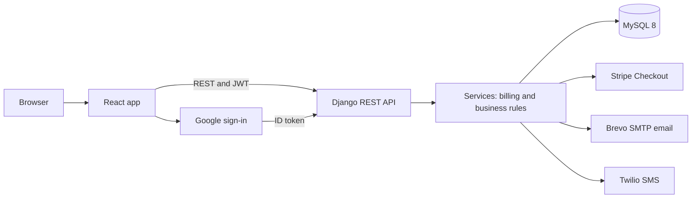
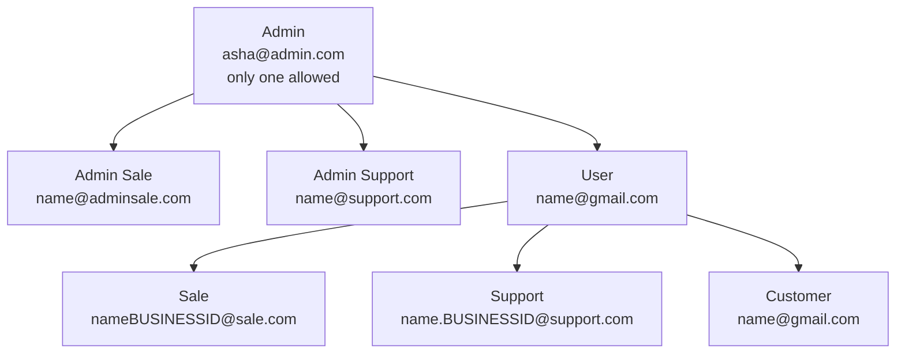
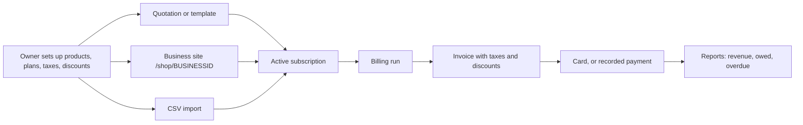
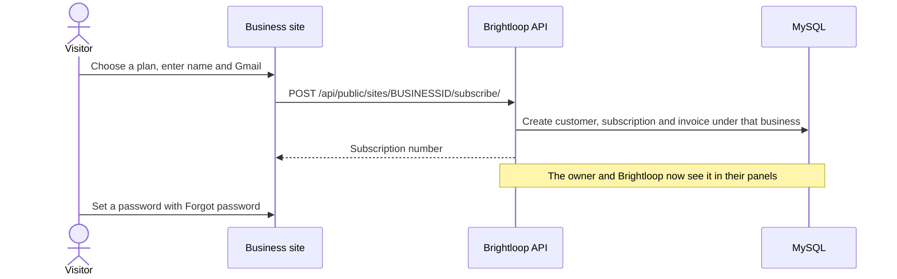
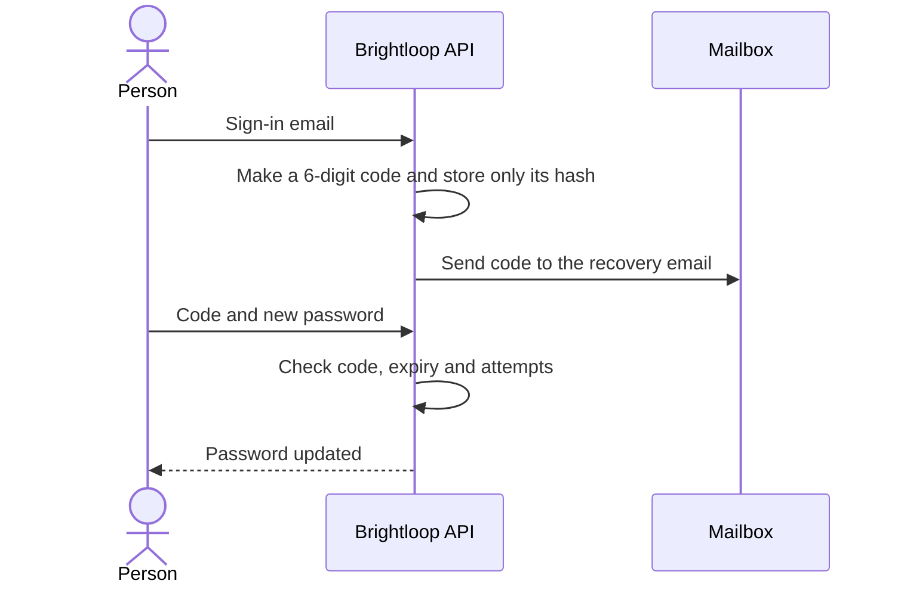
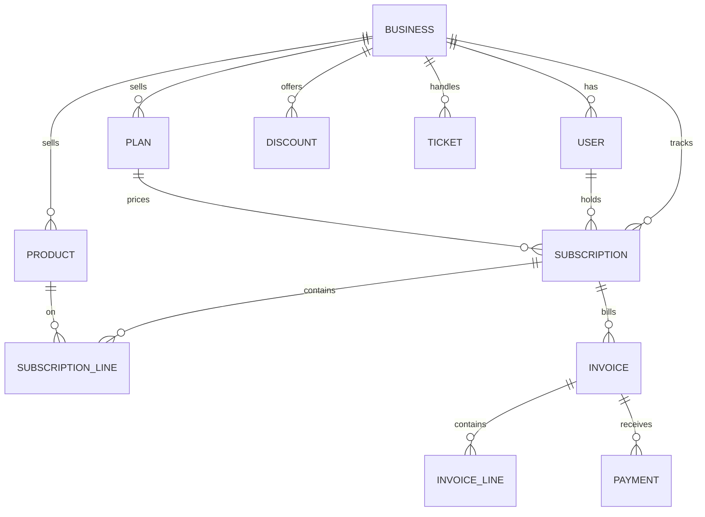

#please try running this code it was impossible to describe a full fledge near production code in just 10 minutes in a video 
# Brightloop

Brightloop is a subscription management platform for many businesses. Each business runs its own plans, billing, payments, support and sales here, and Brightloop tracks the subscriptions made on their sites.

- Brief: [docs/PROBLEM.md](docs/PROBLEM.md)
- Requirements and assumptions: [docs/ANALYSIS.md](docs/ANALYSIS.md)
- Design: [docs/ARCHITECTURE.md](docs/ARCHITECTURE.md), [docs/DECISIONS.md](docs/DECISIONS.md)
- Plan and status: [PLAN.md](PLAN.md)
- each account have same common password Brightloop@123

## Tech stack

| Layer | Technology | Used for |
|-------|------------|----------|
| Frontend | React 18, Vite 6, React Router 6 | Landing page, panels, customer portal, business sites |
| Backend | Python, Django 5.2 LTS, Django REST Framework | REST API and business rules |
| Sign-in | SimpleJWT, Google sign-in | Access tokens, and sign-in with a Google account |
| Database | MySQL 8 | All data, with row locks and unique rules against double billing |
| Payments | Stripe Checkout, test mode | Card payment of invoices |
| Messages | Brevo SMTP, Twilio | Email through Brevo, and SMS reminders through Twilio once set up (see [Integrations](#integrations)) |
| Quality | Django tests, Ruff, GitHub Actions | Tests and lint on every push |



## Who is who

There are two levels of admin panel. Brightloop runs the platform, and each business owner runs their own business inside it.



### The address decides the account

| Address | Account | Opens on |
|---------|---------|----------|
| `asha@admin.com` | The one administrator | Brightloop overview |
| `name@adminsale.com` | Brightloop sales | Sales page |
| `name@support.com` | Brightloop customer care | Tickets |
| `name@gmail.com` | Business owner | Finance summary |
| `name@gmail.com`, with a Business ID at sign-up | Customer of that business | Customer portal |
| `nameBUSINESSID@sale.com` | That business's sales | Sales page |
| `name.BUSINESSID@support.com` | That business's customer care | Tickets |

Each business gets a unique 6-character Business ID to share with its team.

- Nobody can sign up with a Brightloop address. Only the administrator creates them.
- A team member who joins with a Business ID stays locked until the owner approves them.
- One address belongs to one business.
- Everyone must add a recovery email after first login.

### What each account can do

| | Administrator | Business owner | Sales | Customer care | Customer |
|---|---|---|---|---|---|
| Metrics and users across all businesses | Yes | No | Brightloop staff only | Brightloop staff only | No |
| Suspend a business | Yes | No | Brightloop staff only | Brightloop staff only | No |
| Plans, products, taxes, discounts, promo codes | Own business | Own business | Read | Read | No |
| Add, approve and delete staff | Brightloop staff | Own staff | No | No | No |
| Finance summary, revenue, payments, billing, import | Own business | Own business | No | No | No |
| Subscriptions and invoices | Own business | Own business | Only what they sold | All in the business | Own |
| Tickets | Own business | Own business | No | All in the business | Own |
| Team chat and admin chat | Yes | Yes | Yes | Yes | No |
| Sales targets and metrics | Sets targets | Sets targets | Own figures | No | No |

Brightloop itself is stored as a business. Its customers are the business owners, so an owner's plan appears under **My Brightloop plan**.

## Data flow

### From plan to revenue



### Stages

| Record | Moves through |
|--------|---------------|
| Subscription | Draft, Quotation, Confirmed, Active, Closed. Paused is a state beside Active |
| Invoice | Draft, Confirmed, Paid. Cancelled is also possible |

### A subscription made on a business's site



### Forgot password



A code expires in 10 minutes. Each account gets 3 codes and 5 guesses an hour.

### How the data is organised



Every business's records carry its `business` ID, and requests are limited to the signer's own business. An ID from another business acts as if it does not exist.

## Features

| Area | Features |
|------|----------|
| Accounts | Sign-up, Google sign-in, password rules, one-time code to reset, compulsory recovery email |
| Catalog | Products with variants, plans with per-plan options, free trials, taxes, payment terms, quotation templates |
| Subscriptions | Stages, automatic renewal with opt-out, pause, add-ons, plan changes with proration, activity timeline |
| Billing | Bill everything due at once, automatic tax and discounts, catch-up of missed periods, no double billing |
| Discounts | Fixed or percentage, minimums, dates and usage limits, for products or whole subscriptions |
| Promo codes | Discount, account credit, free days or a custom perk |
| Invoices | Confirm, cancel, send, print, bulk confirm and send |
| Payments | Card through Stripe, recorded payments with method, amount, date and note, admin approval of outside payments |
| Finance | Active subscriptions, MRR, ARR, churn, collected, owed, overdue, date filters, CSV exports, overdue reminders |
| Revenue | Revenue recognition, deferred revenue, monthly history, breakdown by plan and customer |
| Support | Tickets with internal notes and escalation, a team chat per business, an admin chat with Brightloop |
| Sales | Who they sold to, monthly targets and metrics |
| Brightloop | Overview of all businesses, user management, suspending a business |
| Sites | Animated landing page, a public site per business, CSV import with sample data |

## Speed

The slowest page API measured **199 ms** with 5,000 extra subscriptions on one business, on a development machine. The brief's limit is 2 seconds.

| Technique | Where |
|-----------|-------|
| Composite indexes that start with `business` | Subscriptions, invoices, payments, tickets, chats |
| Grouped SQL in place of row-by-row loops | Finance summary and Brightloop overview |
| Hash maps for constant-time lookups | CSV import, and joining overview figures |
| Whole-paise integer arithmetic | Revenue recognition, so months add up exactly |
| Pagination | Every list |

## Run it

You need Python 3.12 or later, Node 20 or later and MySQL 8. Run these from the repository root in PowerShell.

1. Create the database and user. The SQL is in [docs/SETUP.md](docs/SETUP.md), step 3.
2. Copy `.env.example` to `.env`, then set `SECRET_KEY` and `DB_PASSWORD`, and set `DEBUG=true`.
3. Set up and start the backend:

   ```powershell
   python -m venv .venv
   .venv\Scripts\pip install -r backend\requirements.txt
   .venv\Scripts\python backend\manage.py migrate
   .venv\Scripts\python backend\manage.py seed_demo
   .venv\Scripts\python backend\manage.py runserver
   ```

4. In a second terminal, start the frontend, then open http://localhost:5173:

   ```powershell
   cd frontend
   npm ci
   npm run dev
   ```

### Starting logins

All use the local password in `backend/billing/management/commands/seed_demo.py`. Each person adds their own recovery email at first login.

| Login | Account |
|-------|---------|
| `asha@admin.com` | Administrator |
| `ravi@adminsale.com` | Brightloop sales |
| `neha@support.com` | Brightloop customer care |
| `manbhwan@gmail.com` | Owner of Manbhwan Foods, Business ID `mb7k2q` |
| `rohanmb7k2q@sale.com` | Manbhwan sales |
| `pooja.mb7k2q@support.com` | Manbhwan customer care |
| `priya@gmail.com`, `rahul@gmail.com` | Manbhwan customers |
| `sunrise@gmail.com` | Owner of Sunrise Fitness, Business ID `sr4n9x` |
| `meera@gmail.com` | Sunrise Fitness customer |

Manbhwan's public test site is at `/shop/mb7k2q`.

These sample addresses may belong to real people. With real email on, invoices, reminders and password codes for them could reach strangers, so replace them with real addresses first.

## Integrations

Each is set in `.env`, and stays hidden or off until configured. See `.env.example`.

| Integration | Needs | Status without it |
|-------------|-------|-------------------|
| Email through Brevo | `EMAIL_BACKEND=django.core.mail.backends.smtp.EmailBackend`, `EMAIL_HOST=smtp-relay.brevo.com`, `EMAIL_PORT=587`, `EMAIL_USE_TLS=true`, your Brevo login and SMTP key as `EMAIL_HOST_USER` and `EMAIL_HOST_PASSWORD`, and `DEFAULT_FROM_EMAIL` set to a verified Brevo sender | Emails are saved in `backend/sent_emails/`. With `DEBUG` on, the password code shows on screen |
| Email through Twilio, instead of Brevo | `EMAIL_BACKEND=config.email.TwilioEmailBackend`, `TWILIO_API_KEY_SID`, `TWILIO_API_KEY_SECRET`, and `DEFAULT_FROM_EMAIL` on a domain verified in Twilio | Emails are saved in `backend/sent_emails/`. With `DEBUG` on, the password code shows on screen |
| Stripe Checkout | `STRIPE_SECRET_KEY`. Add `STRIPE_WEBHOOK_SECRET` and an endpoint at `/api/webhooks/stripe/` to record payments if a customer never returns | The Pay by card button is hidden |
| Twilio SMS | `TWILIO_ACCOUNT_SID`, `TWILIO_API_KEY_SID`, `TWILIO_API_KEY_SECRET`, `TWILIO_FROM_NUMBER` | Reminders go by email only |
| Google sign-in | `GOOGLE_CLIENT_ID`, with `http://localhost:5173` as an authorised JavaScript origin | The Google button is hidden |

Twilio's trial sender (`@twilio.email`) only sends approved templates, so password codes need a verified domain.

## Commands

| Task | Command, from `backend/` |
|------|--------------------------|
| Run all tests (needs MySQL) | `..\.venv\Scripts\python manage.py test` |
| Bill everything due, across all businesses | `..\.venv\Scripts\python manage.py run_billing` |
| Remind about overdue invoices | `..\.venv\Scripts\python manage.py send_reminders` |
| Add volume data for speed checks | `..\.venv\Scripts\python manage.py seed_demo --volume 5000` on an empty database |
| Lint | `..\.venv\Scripts\ruff check .` |

Schedule `run_billing` and `send_reminders` daily with cron or Task Scheduler if you want them to run by themselves. Otherwise, use the **Run billing** and **Send overdue reminders** buttons.

## Known limits

- All Stripe test payments land in one Stripe account. Giving each business its own needs Stripe Connect.
- Only the hosted `/shop/BUSINESSID` page reports subscriptions. There is no API for a business's own website yet.
- The business site does not confirm that a new address belongs to the person typing it.
- The compulsory recovery email is enforced in the app's screens, not in the API.
- The app is set up to run locally, and is not deployed.
