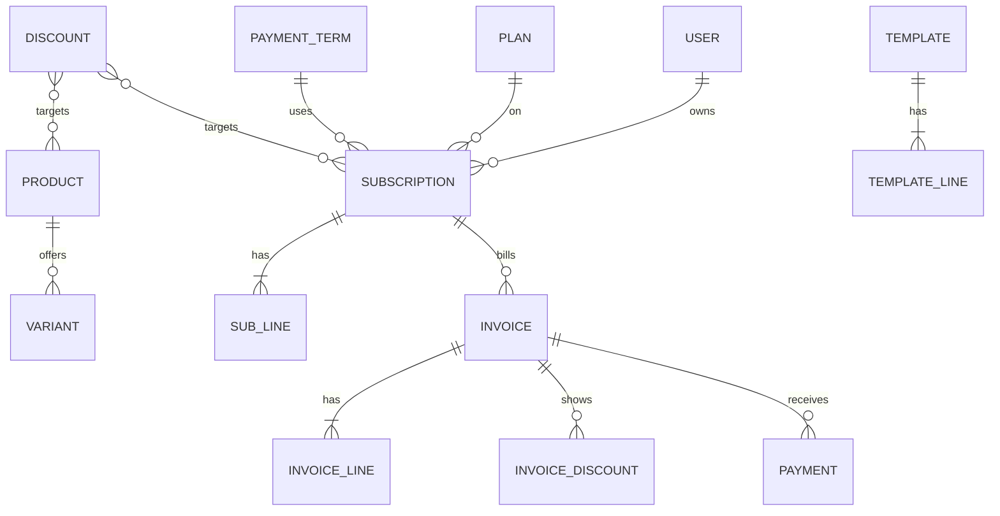

# Architecture

| Layer | Choice | Reason |
|-------|--------|--------|
| Backend | Django 5.2 LTS, Django REST Framework, SimpleJWT | Fast to build, strong ORM and transactions |
| Frontend | React with Vite, React Router | Config-driven CRUD keeps code small |
| Database | MySQL 8 | Already installed |
| Scheduling | `run_billing` command, run daily by cron or Task Scheduler, plus a Run billing button | No extra infrastructure |

## Data model

## Key rules

- **No double billing:** `Invoice.billing_key` (`<subscription>:<period start>`) is unique, and is cleared only when an invoice is cancelled for rebilling. MySQL allows many NULLs.
- **No skipped periods:** billing loops from `next_invoice_date` until it passes today, under a row lock, and each subscription has its own transaction so one failure cannot block the run.
- **Permissions:** enforced in viewsets. Querysets are scoped to the customer. Serializers expose `allowed_actions` so the UI shows only valid buttons.
- **Performance:** indexed status and date columns, paginated lists, `select_related`, SQL aggregates, and stored invoice totals.

## API

`/api/auth/*`, `/api/customers`, `/api/staff`, `/api/products`, `/api/taxes`, `/api/plans`, `/api/payment-terms`, `/api/discounts`, `/api/templates`, `/api/subscriptions` (with actions), `/api/invoices` (with actions), `/api/payments`, `/api/billing/run`, `/api/reports/summary`.
